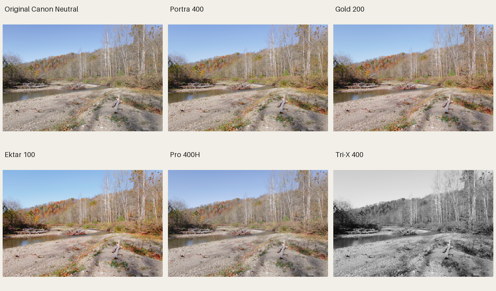
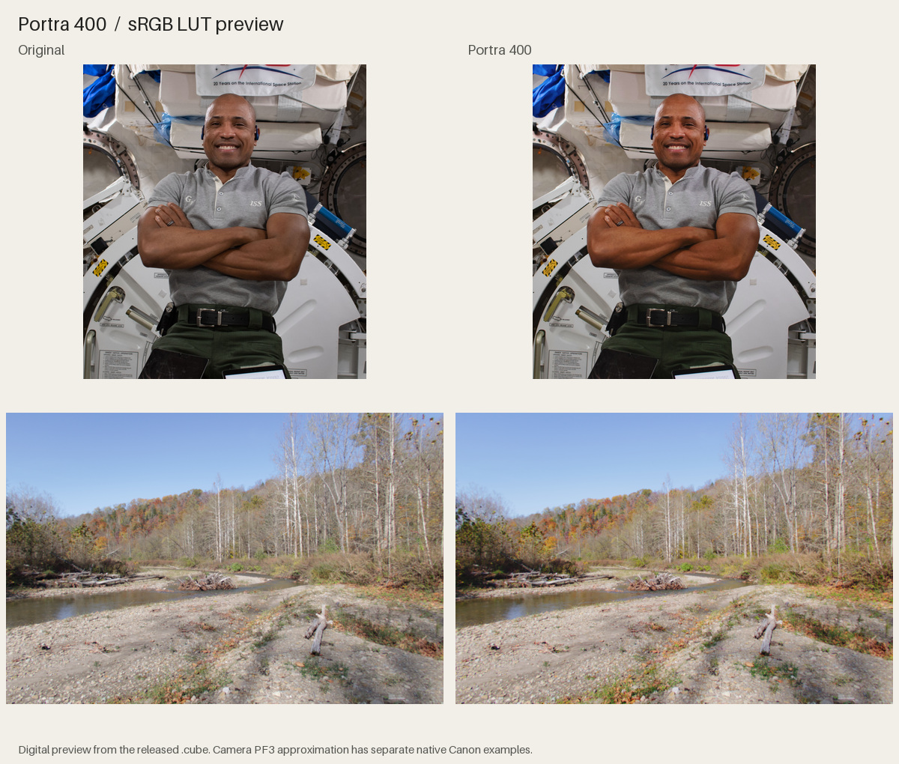
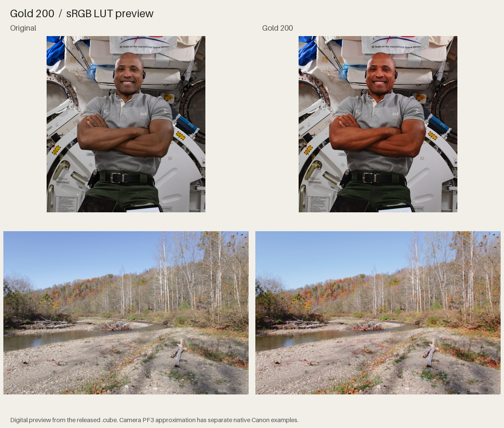
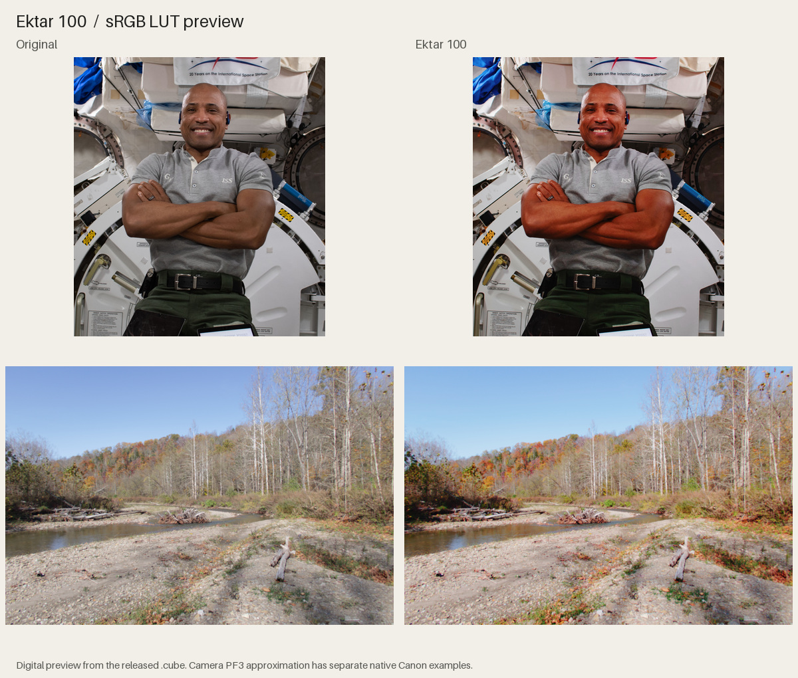
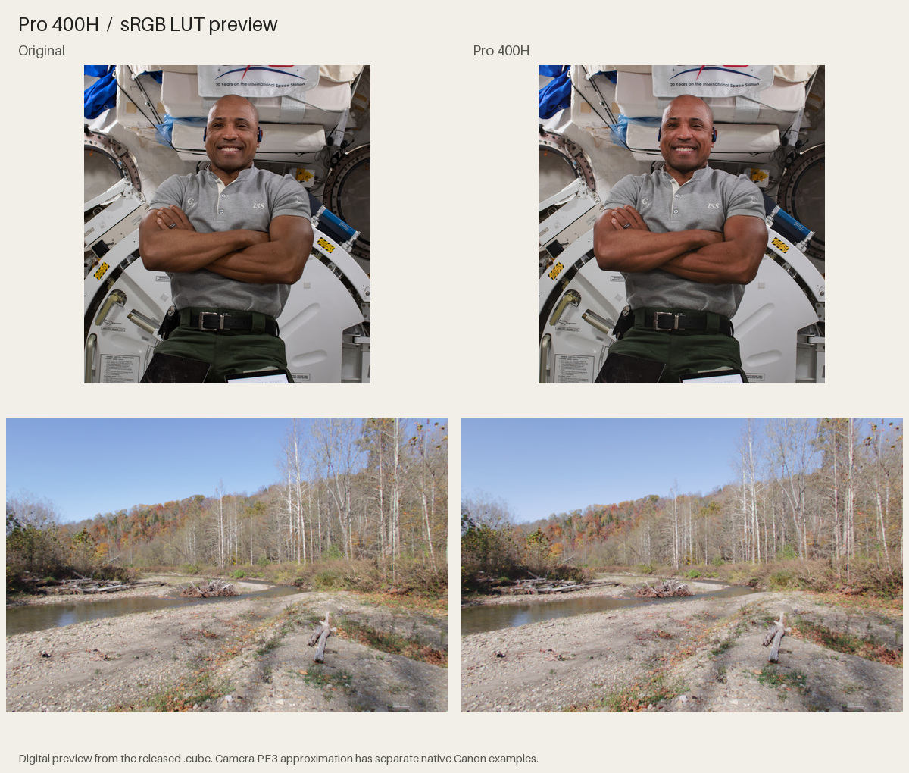
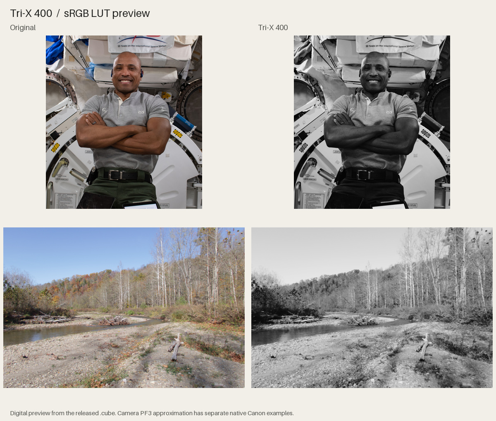

# G7X Film Lab

**Five film-inspired looks for the Canon G7 X Mark III**, as ready-made Picture Styles and sRGB LUTs. Includes an offline installation guide, 25 photo comparisons, native Canon software previews, and reproducible source.

[**Download the ready-to-use pack**](https://github.com/Nielk74/g7x-film-lab/releases/download/v0.1.0/G7X-Film-Lab-0.1.0.zip) · [Install instructions](docs/INSTALL.md) · [Validation](docs/VALIDATION.md) · [Model and data sources](docs/FILM_MODELS.md)



The camera files pass Canon’s actual parser and its G7 X III model compiler offline. **Physical camera registration and camera JPEG output remain untested.** The looks model published film responses with an explicit display-input adaptation; matching a particular Portra scan still requires a controlled film/camera comparison. Grain and halation are not carried by a color LUT.

## Install without building anything

1. Download and extract the [release ZIP](https://github.com/Nielk74/g7x-film-lab/releases/download/v0.1.0/G7X-Film-Lab-0.1.0.zip). Double-click **START-HERE.html** for the visual guide and before/after gallery.
2. Install Canon’s **Picture Style File Registration Tool**: [Mac](https://sg.canon/en/support/0200746802) or [Windows](https://sg.canon/en/support/0200746702).
3. Connect the G7 X III over a USB-C data cable in **P** mode. Select the camera, choose a **User Def.** slot, browse to one of the ready-made files in `profiles`, and click **Register**.
4. Select that User Def. Picture Style on camera. Try RAW + JPEG and fixed white balance for the first comparison.

The camera stores **three** user styles at once; choose any three of the five. Suggested first set: Portra 400, Gold 200, Tri-X 400. No Python or source build is needed. Canon’s Mac registration-tool page lists macOS 13–15; USB operation on macOS 26 has not been established. See [the complete guide](docs/INSTALL.md) for labels, restore/swap guidance and troubleshooting.

## The five looks

| Look | Intended rendering | Camera file | Desktop LUT |
| --- | --- | --- | --- |
| Kodak Portra 400 inspired | Restrained portrait contrast, natural skin and open highlights | [G7P400.PF3](profiles/G7P400.PF3) | [portra400.cube](luts/portra400.cube) |
| Kodak Gold 200 inspired | Warm color separation and a familiar everyday negative feel | [G7G200.PF3](profiles/G7G200.PF3) | [gold200.cube](luts/gold200.cube) |
| Kodak Ektar 100 inspired | More color and contrast, with soft gamut containment | [G7E100.PF3](profiles/G7E100.PF3) | [ektar100.cube](luts/ektar100.cube) |
| Fujifilm Pro 400H inspired | Gentler tone and distinct color relationships, neutrally timed | [G7F400.PF3](profiles/G7F400.PF3) | [pro400h.cube](luts/pro400h.cube) |
| Kodak Tri-X 400 inspired | Panchromatic black and white, referenced to D-76 development | [G7TX400.PF3](profiles/G7TX400.PF3) | [trix400.cube](luts/trix400.cube) |

The `.cube` files are 65³ **encoded SDR sRGB → sRGB**, range 0–1. They are not log conversion LUTs. Develop RAW or convert log/HDR into the declared input space first. The PF3 camera tables sample the same look at Canon’s 33³ / 12-bit representation. The file also contains an approximate parametric representation for Canon desktop preview; that preview is separately measured and can differ from the full table.

## Examples of every LUT

Each sheet compares the same input photograph with the exact released desktop LUT. The portrait is a NASA digital photograph; the landscape is a CC0 G7 X III RAW developed with Canon’s native Neutral rendering. These are digital previews, not film scans or styled out-of-camera JPEGs. The offline guide includes all five scenes for each look: skin, coffee, landscape, night and the G7 X III sample. [Photo credits](examples/source/CREDITS.md).

### Portra 400



### Gold 200



### Ektar 100



### Pro 400H



### Tri-X 400



## How much of this is measured?

Film behavior starts with Fotufilm’s manufacturer-data-based profiles: spectral sensitivity, characteristic density curves and modeled dye behavior. The build uses a fixed 5500 K virtual light, fixed print placement, and no scene metering. An extended gray-ramp inverse adapts the model to already rendered digital inputs; fixed neutral timing and soft gamut compression prevent strong crossover tints and hard color-channel clipping. These finishing choices are authored and disclosed, not additional manufacturer measurements.

The retained [quality report](research/quality.json) measures interpolation against that specified numerical model. Canon parser/readback, native desktop rendering, and model-specific camera compilation are separate gates. None is a measurement of accuracy against physical Portra rolls. [Validation details and native Canon previews](docs/VALIDATION.md).

## Optional desktop preview command

Run this from a source checkout of the repository:

```sh
python3 -m pip install .
g7x-film input.jpg --lut luts/portra400.cube --output portra-preview.jpg
```

The command converts an embedded color profile to sRGB, applies the LUT once, and refuses to overwrite the original or an existing output. It does not connect to the camera.

## Build and research

[Rebuild instructions](docs/BUILD.md) explain the pinned Fotufilm model, optional Swift/Halide baker, deterministic PF3 generation, numerical checks and release packaging. Prebuilt profiles, an original mathematical identity calibration asset and source data are included; no Canon software, firmware, private reference profiles or fixed cipher-key arrays are redistributed.

## Credits and licenses

Film modeling uses **Fotufilm**, Copyright 2026 MUAStudio Inc., [fotufilm.com](https://fotufilm.com), pinned at `3a789c436716c902654f248166ebb4f580611146`. Film profile data and derived LUT/PF3 assets are **CC BY-SA 4.0**; project code is **MIT**. [Data license and modifications](DATA-LICENSE.md) · [Photo credits](examples/source/CREDITS.md).

The independent PF3 implementation was informed by the [Style Studio format research](https://github.com/LvClFER/Lut-to-Canon-Picture-Style); its source and profile files are not vendored. This project is not affiliated with Canon, Kodak, Fujifilm or Fotufilm.
