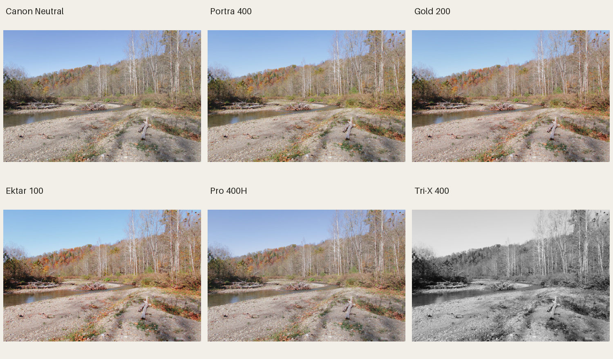
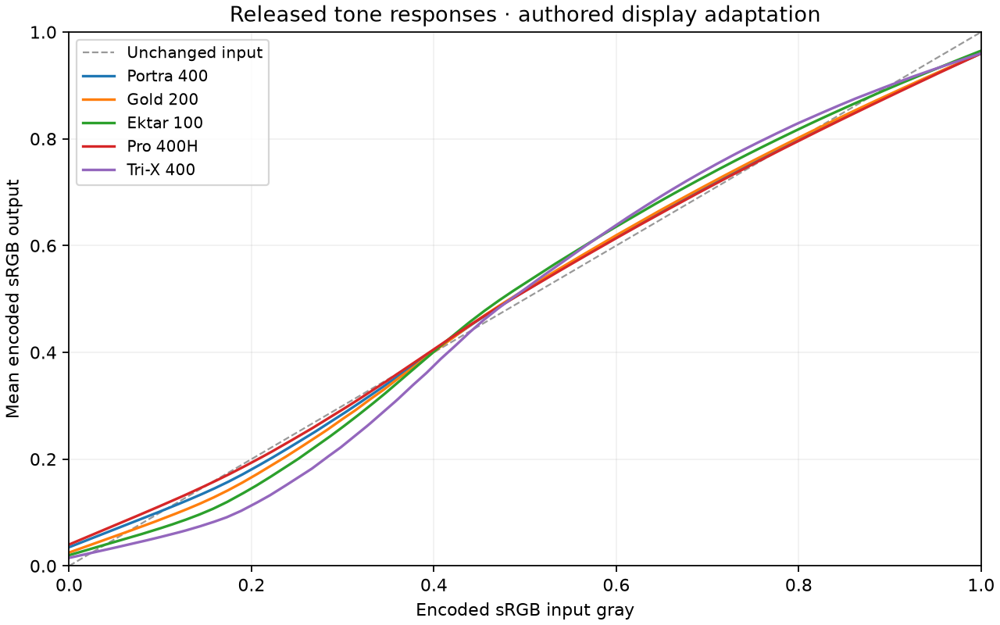

# What was tested

The release has five distinct evidence layers. Each answers a different
question; the limits are kept with the results.

| Layer | Result | What it establishes |
| --- | --- | --- |
| Independent format/code checks | Passing | CUBE ordering/interpolation, PF3 bounds/checksums, typed fields and exact profile reconstruction |
| Direct-model holdouts | 8,192 seeded colors per look, plus permutation checks | The 65³ LUT reproduces the specified numeric model and authored finishing; no hidden frame metering or spatial dependence |
| Independent photo/neutral review | Five scenes per look, 8,193-point neutral ramps | Continuous highlights, neutral timing, black-and-white neutrality and visible color-gradation checks |
| Canon native parser and G7 X III compiler | All five profiles pass; five distinct compiled color-data tails | Canon can read the intended tables and its model `0x808` implementation consumes the dense look data |
| Native Canon RAW rendering | All five desktop-preview approximations render; repeat passes stable | The parametric editing fields produce the intended approximate look in Canon's desktop path |

**Not yet measured:** physical USB registration, actual G7 X III JPEG output,
or accuracy against a controlled physical-film/scanner reference pair.

## The full look and the Canon desktop preview

The camera file contains the complete 33³ look in two dense records. Canon's
correctly initialized camera compiler reads those records. The exact input
tables and hashes are checked in
[canon-camera-compiler-validation.json](../research/canon-camera-compiler-validation.json).

Canon's tested DPP path instead builds its desktop appearance from parametric
curves and polynomial color fields. An arbitrary dense LUT cannot be represented
exactly by those limited fields, so the file carries a fitted approximation for
that preview path. It must not be mistaken for the full camera table. The
approximation can differ more in saturated colors. Do not open/re-save a
downloaded profile in an editor expecting it to preserve every independent
representation; register the supplied file as downloaded.

The comparison below uses one CC0 G7 X III RAW, the same WB and exposure,
and the same native Canon baseline for every look. It demonstrates desktop
software behavior, not a photo captured with the profile installed on camera.

## Measured reports

- [Direct-model and 33/65-grid interpolation errors](../research/quality.json).
- [Independent neutral, clipping and photo review](../research/independent-lut-review.json).
- [Native Canon parser, table readback and RAW comparisons](../research/canon-native-validation.json).
- [Native G7 X III compiler and dense-table controls](../research/canon-camera-compiler-validation.json).
- [Exact film profile sources and conditions](../research/film-sources.json).
- [Every example linked to its exact LUT hash](../research/example-renders.json).

The reported Delta E values compare software representations of this project's
look. They are not claimed film-match scores. In the native RAW comparison,
the parametric Canon desktop approximation has a mean Delta E76 around
0.4–1.9 on the selected landscape. Its random full-gamut holdout error is
larger; see each `research/camera-fits` report for distribution and extremes.

## How to validate on a camera

Register one profile into a chosen replaceable User Def. slot using Canon's
PowerShot tool. With fixed lighting, WB and exposure, shoot RAW + JPEG of
skin, gray/white patches, foliage, blue sky and a bright highlight. Compare
against Neutral with otherwise identical settings. Record firmware, tool/OS
version and actual camera results before claiming camera-output fidelity.
Film matching needs a further same-scene reference with a declared film,
exposure, development and scan/print process.
